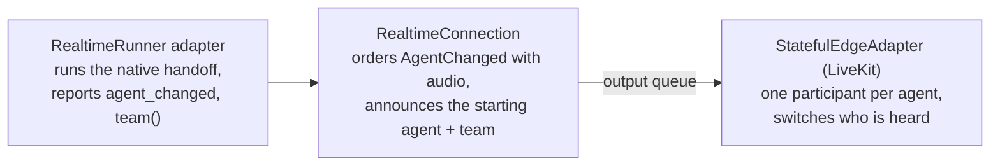

# #809: Realtime multi-agent handoffs with LiveKit agent participants

Let one realtime voice call move between agents through the framework's own handoffs (OpenAI Agents SDK `handoffs`, Google ADK `sub_agents` transfers), and show every agent of the call as its own LiveKit participant with only the active one unmuted. Each layer of the realtime design from #405 gets one job: the framework adapter runs the native handoff, the pool carries one new framework-neutral event, `AgentChanged`, in order with the audio, and the edge decides what the change means to the caller.

## Motivation

- Realtime calls support one agent only; native handoffs are silently ignored.
  - The OpenAI adapter offers the model only the root agent's own tools; `handoffs` are never read (`ak-py/src/agentkernel/framework/openai/openai.py:702`, the loop at `:713`).
  - The ADK adapter offers only `tools` (`ak-py/src/agentkernel/framework/adk/adk.py:1000`, `:1011`) and opens one Gemini Live socket per call, configured for the root agent (`:1032`); `sub_agents` are never read.
  - Result: an agent that says "let me transfer you" cannot.
- The output stream does not say which agent is speaking (the realtime events are `AudioDelta`, `TextDelta`, `Interrupt`: `ak-py/src/agentkernel/core/event.py:142`).
- The LiveKit gateway holds one room connection and one audio track (`ak-py/src/agentkernel/integration/livekit/adapter.py:76-77`), with one identity per gateway (`:68`): a room can show one agent.
- The transcript is emitted at once while its audio is paced (`ak-py/src/agentkernel/pipeline/realtime_pool.py:121`), so text can reach the edge ahead of the audio it belongs to: after a speaker change it would be attributed to the wrong agent.
- A new connection's delivery context is set only after it connects (`ak-py/src/agentkernel/pipeline/realtime_pool.py:504-506`), so output emitted while connecting has no edge to route to.
- The #405 design does not cover handoffs (`docs/specs/405-livekit-realtime-voice/design.md`).

## Requirements

### Shared contract

- Add `AgentChanged(agent: str, previous_agent: str | None, agents: list[str] | None)` to the `StreamEvent` union in `core/event.py`.
  - JSON primitives only, so it crosses every queue transport.
  - `agents` is set only on the first event of a connection: every agent the conversation can hand off to, the starting agent first.
  - AG-UI leaves it unmapped, as it leaves `AudioDelta` and `Interrupt`.
- `RealtimeRunner` (`core/realtime/runner.py`) gains:
  - an `agent_changed` callback event: `{"agent", "previous_agent"}`, reported after the previous agent's last output and before the new agent's first;
  - `team(agent) -> list[str]`, read before connecting, never raising; the default returns `[agent.name]`, so a bring-your-own adapter without handoffs keeps working;
  - a shared `_cancel_and_wait(task)` that stops the socket listener and waits for it, used by both adapters' `disconnect()`.
- `StatefulEdgeAdapter.deliver_chunk()` documents `AgentChanged`; an edge with a single voice line may ignore it.

### Pipeline (`RealtimeConnection`, `RealtimeConnectionPool`)

- On `connect()`, queue `AgentChanged(<starting agent>, agents=adapter.team(...))` ahead of any output; again on every new connection (a reconnect starts at the entry agent).
- Audio, transcript, `done`, `interrupt` and `agent_changed` go through the one paced queue, in the order the adapter reported them.
  - On a barge-in, drop queued audio and transcript; keep `done` and `agent_changed`.
  - Reset the pacing window on every control event, so a reconnect gap is not paid back as a burst.
- `get_or_create()` applies the delivery context (`request_id`, `user_id`, `integration`, `reply_context`, keyword-only) before connecting.
- One room = one AK session = one `RealtimeConnection`; unchanged.

### OpenAI adapter (`OpenAIRealtimeRunner`)

- Offer each enabled handoff as a function, collected as the SDK's runner collects them (`handoff()` for a plain `Agent`, `is_enabled` respected).
- A handoff call goes through the pool's tool path, as in the SDK's own `RealtimeSession`.
  - `execute_tool()` invokes the SDK's `on_invoke_handoff()`, inside AK's session scope.
  - `send_tool_result()` switches the session on the same socket with `session.update` (the new agent's instructions and tools), reports `agent_changed`, then adds the output.
  - A new agent with no instructions sends `instructions: ""`, so it does not keep the previous agent's.
- A tool runs as the agent that called it, even when a handoff in the same response switched agents first.
- Only the first handoff of a response is performed; any other is answered as not performed.
- An agent that cannot be activated (its instructions, tools or handoffs fail to resolve) leaves the active agent unchanged, and the model gets an error result.
- At connect, walk the handoff graph and raise for a handoff with `input_filter` or `nest_handoff_history` (the history lives on OpenAI's side); warn for an agent declaring another model.
- `team()` follows plain agents and `handoff()` wrappers, skipping `is_enabled=False`.

### ADK adapter (`GoogleADKRealtimeRunner`)

- An agent with transfer targets, by ADK's rules (sub-agents; parent and peers unless `disallow_transfer_to_parent` / `disallow_transfer_to_peers`; not sub-agents in `task` / `single_turn` mode), gets:
  - ADK's `TransferToAgentTool` (`agent_name` limited to the targets);
  - ADK's transfer instructions, from ADK's own builder (`agent_transfer._build_transfer_instructions`), which gives none to an agent in `task` / `single_turn` mode.
- A transfer is any tool call that leaves `tool_context.actions.transfer_to_agent` set, as in ADK.
- The results of one Gemini `tool_call` message are answered together, in call order, as ADK answers parallel calls.
- A transfer replaces the socket, as ADK's `run_live` does:
  - stop the listener, report `done` then `agent_changed`, close the socket;
  - open one configured for the target (its instructions, tools and `generate_content_config.speech_config` voice), within `TRANSFER_CONNECT_TIMEOUT_SECONDS` (15 s), else report `error`;
  - seed it with the history: transcribed user and agent text plus every tool call and result, with `history_config.initial_history_in_client_content`, and `"."` after a user-ending history on Gemini 3.x Live.
- At connect, every agent the conversation can reach must be an `LlmAgent` with a Live model (its own or an ancestor's) and a string instruction; otherwise raise.

### LiveKit edge (`LiveKitEdgeGateway`)

- Start as one participant: it listens to the caller and speaks for the starting agent.
- On the first `AgentChanged` with `agents`, join every other agent as its own participant (`agent-<name>`, its own token and track), in the background, muted.
  - Only the first participant subscribes to tracks; our own participants' audio and chat are never input.
  - A reconnect's announcement joins only the agents not in the room yet.
- On `AgentChanged`, the previous agent's queued audio plays out (at most `PLAYOUT_WAIT_SECONDS`, 2 s), then it is muted and the new agent unmuted.
  - A handoff to an agent still joining speaks through the first participant and moves to its own once joined; a still-joining agent is logged at info, an agent that cannot join is warned about once.
- Each participant carries `ak.active` (`ACTIVE_ATTRIBUTE`), updated in the background with `ATTRIBUTE_TIMEOUT_SECONDS` (5 s); nothing waits on LiveKit's confirmation.
- A participant that fails to join speaks through the first one; a failed start or a dropped room takes every participant out.
- A single agent, or a gateway given only a pre-made `token`, stays one participant (the latter with a warning).

### Configuration

- No new configuration.
  - The team is announced by the conversation, so the gateway needs no list of agents and works when it runs in another process (`kafka`, `nats`, `sqs`).
  - Showing agents reuses `livekit.api_key` / `livekit.api_secret` to mint each participant's token.
- `google-adk` floor raised from `>=1.14.1` to `>=1.24.0`, the first release with everything the ADK adapter imports:
  - `google.adk.apps.app.ResumabilityConfig`, already imported on the base branch (`ak-py/src/agentkernel/framework/adk/adk.py:18`), first in 1.16.0: on 1.14.1 and 1.15.0 `agentkernel[adk]` fails to import;
  - `google.adk.tools.TransferToAgentTool`, first in 1.20.0;
  - `agent_transfer._build_transfer_instructions(tool_name, agent, targets)`, first in 1.24.0 (private, so a future ADK release may change it; the tests call it through the adapter).

### Examples and docs

- `examples/api/livekit-voice/{openai,google}/handoffs/`: supervisor, billing and tech_support for an internet support line.
- `docs/docs/integrations/livekit.md` documents the feature and its per-framework limits; `docs/docs/architecture/realtime-internals.md` documents the flows.

## Non-goals

- Running each SDK's own realtime engine (`RealtimeSession`, `run_live`) in place of AK's adapters.
- A different voice per agent on OpenAI (the Realtime API cannot change the voice after the first audio).
- Handoff to a human (warm transfer over SIP), and voice channels other than LiveKit.
- Durable conversation memory across reconnects or process restarts; multiple Agent Runner replicas.
- Guardrails and hooks on realtime turns (unchanged from #405).

## Open questions

- Should showing every agent as a participant be opt-out? Each is a billed LiveKit connection, and there is no switch today.
- Should the `ResumabilityConfig` part of the floor (1.16.0) ship as its own `fix:` PR, since it corrects an import failure that predates this change?
