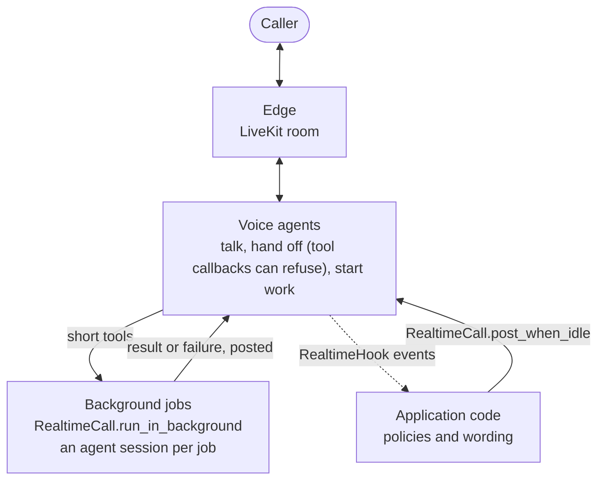

# #810: Realtime multi-agent collaboration with background work

Realtime support for applications in which voice agents and background agents work together: voice agents talk to
the caller, hand off to each other and start work through short tools; background agents do the long work in their
own sessions and report back into the call. The design idea: voice is the meeting room, not the engine. The pool
gains the turn state and an outbox that let application code speak into a call at a quiet moment, and hooks that let
it watch one; the Gemini adapter gains ADK's tool callbacks, authored history, the call's `RunConfig` and connection
recovery. On top of these, the building blocks every such application otherwise builds itself: background jobs,
facts about a call and an idle event, gateways opened and closed per session, and OpenAI's tool input guardrails in
realtime. AK provides the mechanism; the
application keeps the policy and the words. The changes were driven by a full application kept outside this
repository.

Contract background: [`../809-realtime-multi-agent-handoffs/design.md`](../809-realtime-multi-agent-handoffs/design.md),
[`../405-livekit-realtime-voice/design.md`](../405-livekit-realtime-voice/design.md).

## Motivation

- Nothing can refuse a Gemini transfer, so agents with no caller input can hand off to each other forever
  - Realtime ADK calls `tool.run_async` directly (`ak-py/src/agentkernel/framework/adk/adk.py:1435`): the agent's `before_tool_callback`, `after_tool_callback` and `on_tool_error_callback` never run, though ADK's own flow runs them around every tool call (`google.adk.flows.llm_flows.functions`)
  - The built-in `transfer_to_agent` replaces any tool with the same name (`adk.py:1121`), so an application cannot wrap it
  - OpenAI is already covered: a handoff that raises leaves the agent as it is (`openai.py:978`), and the pool returns the error to the model (`realtime_pool.py:247-249`)
- Code outside the pool cannot tell whether the model is speaking or when the caller last spoke
  - `RealtimeConnection.last_activity_at` moves on every caller audio frame (`realtime_pool.py:270`) and every adapter event (`:119`)
  - Text sent into a call always starts a response (`openai.py:932`); one sent while a response runs is only logged by the server (`openai.py:905-906`)
  - The ADK adapter reports no `speech_started`; it reads the caller's transcription only for barge-in (`adk.py:1250`)
- After a Gemini transfer, the new agent cannot tell a teammate's words from its own
  - The adapter replays every agent's turn as the model's own (`role="model"`, no author); ADK presents other agents' turns as user-side context naming the author (`google.adk.flows.llm_flows.contents._present_other_agent_message`)
- An application learns what was said in a call only from log lines (`AI response: ...`)
- An application serving its users a LiveKit page has to read `AKConfig` to sign their tokens
- A call cannot set how Gemini detects the caller's turns or which language it transcribes
  - Turn detection is left to the Live API's defaults (`adk.py:1056-1059`), and both transcriptions are a bare `AudioTranscriptionConfig()` (`adk.py:1090-1091`)
  - ADK's `RunConfig` holds these settings, and `Module.run_options(agent, run_config=...)` already carries one
- A lost Gemini socket ends the conversation
  - A socket error is reported as `error` (`adk.py:1219-1234`), the pool fails the connection (`realtime_pool.py:159-171`), and the next input starts over at the entry agent (`realtime_pool.py:95-98`) with no earlier turns (`docs/docs/integrations/livekit.md:288`)
  - The Live API ends a connection after about 10 minutes and an audio session after 15 minutes without compression; it offers session resumption ([Session management with Live API](https://ai.google.dev/gemini-api/docs/live-session))
  - What the caller says while no socket is open is dropped (`adk.py:1298-1308`), during a transfer too (`adk.py:1360-1361`)
- Background agents cannot share the call's session: the pool runs tools inside the AK session lock (`realtime_pool.py:438`), which `Runtime.run` holds for a whole run (`runtime.py:393`); they run in sessions of their own
- Every application that runs background agents builds the same infrastructure itself
  - A thread with an event loop of its own, kept for the call's life (a model client keeps tasks on the loop of its first call), a queue, a session per job, and a way to drop queued work when the call ends; the example starts a bare thread per job (`examples/api/livekit-voice/google/handoffs/server.py:66`)
  - A guard against starting the same job twice, which cannot race the submission it allows
- A known gap this change does not close: a run that fails reads like an answer
  - Every adapter turns a framework error into an ordinary `AgentReplyText` (`user_facing_error_message`): 10 sites in 6 adapters (`adk.py:534,722`, `openai.py:263,425`, `langgraph.py:624,775`, `pydanticai.py:219,454`, `crewai.py:404`, `smolagents.py:188`); `Runtime.run` cannot tell either (`runtime.py:418-422`)
  - A background job detects failure through its framework's own signal, during the run (the OpenAI Agents SDK calls `RunHooks.on_agent_end` only for a run that finished); see Non-goals
- An application that nudges a stalled team runs a watcher thread per call, and tracks facts the pool already keeps
  - The connection keeps when the caller last spoke, when edge text arrived, when the agent changed and when a tool result was sent (`realtime_pool.py:174-211`); `RealtimeCall` exposes only `connected`, `quiet_for()` and `agent_has_spoken` (`realtime_pool.py:1138-1155`)
- A gateway cannot be stopped on its own, so an application cannot give each session its own room
  - `GatewayRunner` stops only on the process-wide shutdown event (`gateway.py:63`)
  - `LiveKitEdgeGateway.stop()` before its `start()` has made its stop event does nothing, and `start()` then waits forever (`livekit/adapter.py:207,224,249`)
- OpenAI realtime offers no tool that has input guardrails (`openai.py:839-840`), though the SDK's own realtime session runs them (`agents/realtime/session.py:1197`, `openai-agents` 0.20.0)

## Requirements

### ADK tool callbacks in realtime (`GoogleADKRealtimeRunner.execute_tool`)

- Run the calling agent's `before_tool_callback`, `on_tool_error_callback` and `after_tool_callback` around every tool call, `transfer_to_agent` included, in the order and with the short-circuits of ADK's own flow; sync and async callbacks
- `tool_context.actions.transfer_to_agent` is read after the callbacks, so a before-callback that answers blocks a transfer, and one that sets the action requests one
- ADK plugins do not run (realtime has no ADK `Runner`); documented
- An agent with no callbacks behaves as today

### Turn state and caller events (`RealtimeConnection`, both adapters)

- The connection keeps, readable from any thread: whether the model is responding (a response open until its `done`, output still queued, or a tool running), when model output last left and was generated, when the agent last changed, when a tool result was last sent, when the caller was last heard, when edge text last arrived, whether the caller is speaking, and whether the connection is ready
- Internal to the pool: `RealtimeConnection` is not exported; applications use `RealtimeCall`
- New adapter events, none reaching the edge
  - `speech_heard` (ADK: each later transcription of the caller's words); `speech_stopped` (OpenAI server VAD, declared by `RealtimeRunner.reports_speech_stopped`)
  - The ADK adapter reports `speech_started` once per caller turn, while the model is silent
- No change to stream events, queue messages or edges

### Authored history on a transfer (`GoogleADKRealtimeRunner`)

- Each history entry records its author; a transfer's socket is seeded as ADK seeds one: the caller's words as they are, every agent's turn through ADK's `_present_other_agent_message`
- The caller's words are logged per turn (`Caller said: ...`)

### Talking into a live call (`RealtimeCall`, `RealtimeOutbox`)

- A post waits until the call is ready, nobody is talking, the model owes no reply (to the caller, edge text, a tool result, a replayed reconnect or the last post, each bounded), and the call has been quiet for a moment
- One outbox per session, so posts outlive a reconnect; keyed posts replace, `withdraw(key)` drops, posts expire, the queue is bounded
- `RealtimeCall(session_id)` in `agentkernel.pipeline`: `post_when_idle`, `withdraw`, `connected`, `quiet_for()`, `agent_has_spoken`, `close()`
- No configuration: thresholds are constants

### Realtime hooks (`RealtimeHook`)

- `RealtimeHook.on_event(session, agent, event)` in `core/hooks.py`, attached with `Module.realtime_hook(agent, hooks)` to the agent a call starts with; handoffs report to the same hooks
- `RealtimeEvent.type`: `connected`, `caller_said`, `edge_text`, `agent_said`, `agent_changed`, `reconnected`, `disconnected`
- In order, off the audio path; a failing hook is logged and the next runs
- Optional adapter event `caller_transcript`: Gemini reports it; OpenAI does not enable input transcription and reports none

### LiveKit tokens and alias

- `agentkernel.livekit`, the public alias; `LiveKitEdgeGateway.participant_token(identity, name=None, **grants)`, signed with the gateway's key for its own room, refusing agent identities, room grants and a gateway without a key
- The LiveKit examples import the public aliases and sign tokens through the gateway

### Live settings from `RunConfig` (`GoogleADKRealtimeRunner`)

- The starting agent's `run_config` run option applies to every socket of the call: `realtime_input_config`, `input_audio_transcription`, `output_audio_transcription` (transcription stays on)
- A run-options factory is not called for realtime calls; documented

### Connection recovery (`GoogleADKRealtimeRunner`)

- A socket that drops, is closed by the server (its ~10 minute limit included) or stalls is replaced without leaving the agent that had the call
- The new socket is seeded with the conversation and a one-time note that the line dropped, as a transfer's socket is seeded
- Bounded attempts; repeated quick drops give up as an `error`, which fails the connection as today
- What the caller says while no socket is open is held and sent to the next socket; a tool result that arrives after its socket was lost is kept in the history
- A stall is no model progress for a while after the model was given something to answer, or mid-response; a voice turn the model never answers is not detected (documented)
- While recovering, the connection is not ready for posts; a failed connection is released by the pool even if no more input comes
- OpenAI realtime is unchanged

### Background jobs (`RealtimeCall.run_in_background`, `BackgroundJob`)

- `RealtimeCall(session_id).run_in_background(work, *, name, ...) -> BackgroundJob`: runs `async work(job)` off the realtime pool's loop; returns at once
  - One job loop per process, of its own (never the pool's), run by the realtime host (Hosting and lifecycle, below)
  - A session's jobs run one at a time, in the order submitted; other sessions' jobs run beside them
  - Process-local, as `RealtimeCall` is: not a `QueueTransport` backend and not a distributed job service; agents run through `AgentService.run_multi`
  - `work` returns text to post into the call, or `None`; it raises to fail
- `BackgroundJob`: `id`, `name`, `session_id` (the call's), `arguments`, `status` (`queued`, `running`, `done`, `failed`, `cancelled`)
  - `await job.ask(agent, prompt) -> AgentReply`: runs a registered agent through `AgentService.run_multi` in the job's own AK session, `<call session>-job-<job id>`, never the call's; a job's asks share it
  - `ask` returns the reply as the runtime returned it: a framework error arrives as error text (Motivation), so `work` checks its framework's own signal and raises to fail
  - `job.post(text, key=None)`: `post_when_idle` into the call
  - `BackgroundJob.call_session_id(session_id)`: the call's session from a job's session, so a tool the background agent calls finds its call
- Options, all off by default
  - `job_id`: the application's own id (default `<name>-<random>`, so a default id never continues an earlier job's session); a duplicate of a queued or running job's id raises `ValueError`
  - `arguments`: what the job is for, kept on the job
  - `refuse(pending) -> str | None`: called under the session's job lock with its queued and running jobs; a text refuses the submission (`BackgroundJobRefused`), so a check and the submission it allows cannot race
  - `wait_until_heard`: start only once the call has been quiet for a moment (what the agent said before calling the tool has been heard), at most 20 s; no wait without a live call
  - `on_error(job, error) -> str | None`: text to post when `work` raises; without it the error is logged and nothing is posted
- `RealtimeCall.jobs`: the session's queued and running jobs
- `RealtimeCall.close()` also ends the call's jobs: those whose work has not started (one waiting to be heard included) are `cancelled` and never run, the running one finishes, and nothing any of them posts afterwards reaches a later call of the session: a job's post checks the call and queues the text as one step
- Work raising `asyncio.CancelledError` ends its job as `cancelled`, and the call's next job runs; a worker that is itself cancelled hands the queue to a new one, except during host shutdown
- Each job ends once: one terminal status, one `finished_at`, and `on_error` called at most once
- Callbacks run outside the runner's locks, except `refuse`, which runs under the job lock so its check is atomic with the submission: it must be fast and must not call back into the runner (submit, close, post)
- No policy: no retries, no failure counting, no wording beyond log lines

### Hosting and lifecycle (`BackgroundJobRunner`)

- Hosted like the pool: `BackgroundJobRunner.initialize()` and `get_task()`, a `ThreadRunner.Task` (`graceful`, `stop_all_on_failure`) whose `start()` supervises the job loop until `ThreadRunner.shutdown_event` or the runner's own `stop()`
  - The loop runs on a thread of its own; the task's thread starts it, watches it and drives shutdown from outside it, with time-bounded waits, so a loop blocked by application code cannot hold the host
  - Registered beside the pool in `RealtimeAgentRunner._get_extra_tasks()` (`pipeline/agent_runner.py:266`) and `ECSRealtimeAgentRunner._get_extra_tasks()` (`deployment/aws/containerized/akagentrunner.py:299`); the single-process `IOHandler` reaches it through `RealtimeAgentRunner` (`pipeline/io_handler.py:146`)
  - No other execution mode starts a job loop; constructing the runner starts no thread
  - The loop's thread dying fails the host (`stop_all_on_failure`); a job's exception stays that job's
- Submission needs a ready host, and never waits: a voice tool may submit on the pool's loop, which paces the audio
  - No runner in the process, a runner not yet ready, or a runner shutting down: `run_in_background` raises `RuntimeError` at once, saying which and that the realtime host runs the job runner
  - Readiness is established at startup, on a consumer thread: before it opens a call's connection, `RealtimeConnectionPool.get_or_create` waits for an initialized job runner's loop, at most 10 s, beside its existing wait for its own loop (a warning if it is still not ready; the call opens, and submissions raise). No tool runs before a connection exists
  - Connections opening at once wait for the same outcome, under a lock of its own (no connection or job lock held); only a wait that succeeded is remembered, so after a timeout the next connection waits again
  - Shutdown closes admission under the job lock before anything else: a submission either lands first, and is then cancelled by shutdown, or is refused
- Call closure (`RealtimeCall.close()`): as above; it never stops or closes the shared job loop
- Host shutdown (`ThreadRunner.shutdown_event`, or `stop()`), in order
  1. In one step under the job lock: close admission, mark every job's posts suppressed (the calls are closing), and end every queued job and every job still waiting to be heard as `cancelled`
  2. Outside the lock: their `on_error` gets `BackgroundJobCancelled`; nothing it returns is posted, since posts are already suppressed
  3. Give running work `SHUTDOWN_GRACE_SECONDS` (5) to finish
  4. Always, whatever the jobs' status, ask the loop to cancel every task still on it (a cancelled job's worker may still be waiting; finished work may have left tasks of its own, such as an SDK's listener), and give them `CANCEL_CLEANUP_SECONDS` (5) to end; job status alone does not prove the loop clean
  5. Log an error naming each job still not ended, ask the loop to stop, and wait for its thread briefly; the loop closes itself, on its own thread, once it stops
  - Both are cleanup budgets, not a guaranteed shutdown time: application code that blocks the job loop cannot run its cancellation, and Python cannot stop it. The host stops waiting, logs that the loop is still blocked, and that work remains until the process exits (documented)
  - No session worker is restarted during shutdown; nothing on the pool's loop waits on the job thread
- Both bounds are class constants, no configuration: 5 s each, the scale of the existing cleanup bounds (the pool's 2 s, `GatewayRunner.GRACEFUL_STOP_TIMEOUT_SECONDS` of 10 s)
- Intentional change for direct callers: background jobs run only where a realtime host runs the job runner; a script or test with none gets the `RuntimeError` above
- Test support: `BackgroundJobHost` (`pipeline/testing.py`, beside `QueueTransportContract`, which imports `pytest`: for test fixtures, not production scripts) is a context manager that creates a runner, runs its `start()` on a thread and stops it with `stop()`, the production shutdown path
  - It stops only the runner it created; it refuses to start while a runner already exists in the process, and never sets `ThreadRunner.shutdown_event`
  - Test fixtures may host infrastructure this way; application code never touches the internal runner, its loop or its locks
  - `reset()` for AK's own tests stops a runner through the same `stop()`

### Facts about a live call, and an idle event (`RealtimeCall`, `RealtimeHook`)

- `RealtimeCall` reads, `None` without a connection: `last_caller_input_at` (the caller last spoke, or edge text arrived), `last_agent_change_at`, `last_tool_result_at`
- `RealtimeEvent.type` gains `idle`, with `quiet_for` (seconds)
  - Given only to a hook that sets `idle_after_seconds`, once the call has been quiet that long (the outbox's notion of quiet)
  - Each time another `idle_after_seconds` of the same quiet stretch passes (at `n`, `2n`, `3n` seconds), so a policy can wait longer than the threshold without a thread; anything that ends the quiet (caller input, model output, an agent change, a tool result, a post said) starts the count over
  - Delivered through the hook's existing queue: in order with the other events, never two at once, a failure logged; one whose stretch ended before its hook's turn is dropped
- A handover ends a quiet stretch, as caller input and model output do
- `post_when_idle(..., while_quiet=True)`: for the quiet stretch it is made in: not queued unless the call is quiet, and dropped once that stretch ends (anything happens, or a new connection takes over) before it is said
- AK decides nothing: whether to act on `idle`, and what to say, is the hook's

### Gateways per session (`GatewayRunner.stop`, `GatewayPool`)

- `GatewayRunner.stop()`: callable from any thread, before or after `start()`; the runner stops its adapter on its own loop, as at shutdown; a runner stopped before `start()` never starts the adapter
- `GatewayPool(factory)`, `integration/adapter/gateway.py`: one gateway per session, for an application that opens a room per meeting
  - `open(session_id)` builds the adapter with `factory(session_id)` and hosts it on a thread, unless one is already open; returns the adapter
  - `close(session_id)` stops it; `is_open(session_id)`; `close_all()`
  - A gateway whose `start()` fails is logged and forgotten, so the next `open` starts a new one; a factory that raises raises from `open`
  - Any `StatefulEdgeAdapter` with a `session_id`; runs in the process of the Response Handler, as `GatewayRunner` does
  - A gateway leaving unregisters only its own entry, never the one a later `open` registered for the same session

### OpenAI realtime: tool input guardrails (`OpenAIRealtimeRunner`)

- A tool with `tool_input_guardrails` is offered, and its guardrails run before it, in order, as the SDK's realtime session runs them
  - `reject_content`: the tool does not run; the guardrail's message is the tool's result
  - `raise_exception`: `ToolInputGuardrailTripwireTriggered` is raised and logged; the pool answers the model with the error, as for any tool that raises
- Tools that need approval or carry output guardrails stay excluded (no realtime pause); handoffs get no guardrails, since the SDK has none for them (`on_handoff` raising already refuses a handoff)
- This is for OpenAI applications; the Gemini team already refuses tools through ADK's callbacks

### Diagnostics

- The pool warns when its loop is blocked for more than a second; the ADK adapter logs how long the caller waited for an agent to start speaking

### Configuration

- **No new configuration fields.** Reason each candidate was rejected:
  - Turn detection, languages: ADK's `RunConfig` already holds them, carried by `Module.run_options`
  - Post timing, reconnect and stall thresholds: values settled in live runs, kept as constants rather than knobs nobody has asked to tune
  - The idle threshold: per hook (`idle_after_seconds`), since two hooks may want different ones
  - The job loop, the heard wait: constants; a job's options are per call
- No new extra; existing YAML and `AK_*` env vars stay valid

### Example (`examples/api/livekit-voice/google/handoffs/`)

- The existing handoffs example gains: a `before_tool_callback` that refuses a handoff to a specialist until the caller's account is verified, a technician booking that a background job confirms through `post_when_idle`, and a `RealtimeHook` that logs the call
- The booking confirmation is a background job: `book_technician` submits it with `run_in_background` instead of starting a thread, and refuses a second booking while one is under way
- Offline tests; the example runs them in the CI e2e matrix

### Tests

- Offline, against scripted sockets: `ak-py/tests/test_realtime_pool.py`, `test_module.py`, `test_livekit_gateway.py`, `test_ecs_akagentrunner_realtime.py`; the example's `server_test.py`
- New: `test_realtime_jobs.py` (background jobs), `test_integration_gateway_runner.py` cases for `stop()` and `GatewayPool`
- Job hosting: shutdown with only a waiting job, and with a task left by finished work; concurrent first connections waiting for readiness; startup and readiness, repeated `initialize()`, both realtime runner hosts registering the task, graceful shutdown in its order, the shutdown/submission race, no worker restarted after shutdown, a cleanup timeout (cooperative doubles released afterwards, no test thread left behind)
- Live runs on `gemini-3.1-flash-live-preview`, done by the maintainer: handoffs, a background post, a forced drop, a call past 10 minutes

### Documentation and skills

- `docs/docs/integrations/livekit.md`, `hooks.md`; `docs/docs/architecture/realtime-internals.md`
- Background jobs, the call facts, the idle event, `GatewayPool` and OpenAI tool guardrails in `livekit.md` and `realtime-internals.md`
- `.agents/skills/ak-dev-architecture/SKILL.md` (a realtime section), `.agents/skills/ak-dev-testing-conventions/SKILL.md`
- `docs/versioned_docs/` is never edited

## Non-goals

- `RealtimeCall` across processes: it reaches a call only in the process running the realtime pool
- ADK plugins in realtime; recovery for the OpenAI realtime adapter
- Detecting a voice turn the model never answers; bounding the replayed history. The `idle` event reports a quiet call; it does not decide that the team is stuck
- An AK gate for tools and handoffs: ADK's tool callbacks and the OpenAI SDK's tool guardrails and `on_handoff` already refuse them, on both paths; a realtime-only AK gate would make the same agent follow different rules in a call and over REST
- Policies in AK: no handoff limits, retry counts, nudge wording or job refusal rules; an application writes them in its own classes
- Background jobs across processes: a job runs in the process that submitted it, as `RealtimeCall` reaches only that process's calls; no job queue backend, no distributed job service
- Background jobs outside a realtime host: no job loop starts on demand
- Reporting a failed run as failed (a failed-reply type across the 10 adapter error sites), and a generic background-agent tool built on it: the application that drove this change detects failure natively and needs its own steps around each run (citations watched during the run, a check after it), so neither would have a user here; both can come with the application that needs them
- Approval (`needs_approval`) and tool output guardrails in OpenAI realtime: approval needs a realtime pause, which AK does not have
- Gemini's native session resumption: a follow-up. A handoff needs a new socket for the new agent anyway, and the replay already recovers a drop and the ~10 minute limit; resumption would also need context window compression (an audio session ends at 15 minutes without it) and is unproven on the preview Live model
- A browser voice edge (a web page carrying a call with no media server); an application can build one on the public edge seam (`StatefulEdgeAdapter`, `StatefulEdgeRegistry`)
- The application that drove these changes
- Parallel tool calls on a non-realtime ADK run ("Token ... was created in a different Context"): a separate bug fix on its own branch, `bugfix/adk-parallel-tool-context`. A realtime tool call cannot hit it: each gets its own `ToolContext`, and a call's tool calls run one at a time under the session lock

## Open questions

- Resolved: one PR (#818) for all of it; the parts depend on each other (posts on recovery, the example on posts and hooks)
- Resolved: no browser voice edge in this change. AG-UI cannot carry a voice call (no audio events; one HTTP request per turn; the stream path, not the realtime pool), and a browser edge is a new integration that needs its own design: hosting next to `GatewayRunner`, authentication, and the integration checklist. A separate issue if the team wants one
- Resolved: no native session resumption in this change (Non-goals); recovery replays the conversation with a one-time note
- Resolved: a late tool result is kept in the history, not sent to the recovered socket (unverified on Gemini 3.x Live)
- Resolved: tool calls Gemini writes into its words (`transfer_to_agent{...}`) are not stripped in the adapter; edges filter what they show
- Resolved: the building blocks an application needs (background jobs, call facts and the idle event, per-session gateways, OpenAI tool guardrails) ship in this PR, proved by migrating the application that drove them
- Resolved: no failed-reply type and no background-agent tool in this PR (Non-goals): a check on the reply alone cannot tell an error from an answer, so failure is detected during the run, natively, by the job's own code
- Resolved: the idle signal is a `RealtimeHook` event, not a new callback, so it inherits the hooks' ordering, isolation and attachment
- Resolved: one job loop per process, not a thread per call: no thread to leak when an application never ends a call, and no loop closed under a model client's tasks; the realtime host starts it and shuts it down, as it does the pool (no thread started on first use)
- Resolved: the shutdown bounds, 5 s for running work and 5 s for cancellation, as cleanup budgets
- Resolved: `BackgroundJobHost` for test fixtures
- Resolved (revised): the pool and the jobs move together into `pipeline/realtime/` (`pool.py`, `jobs.py`); no compatibility module for the old `realtime_pool.py` path, which was never released (the public path is `agentkernel.pipeline`); `core/realtime/` and `integration/adapter/` are unchanged
