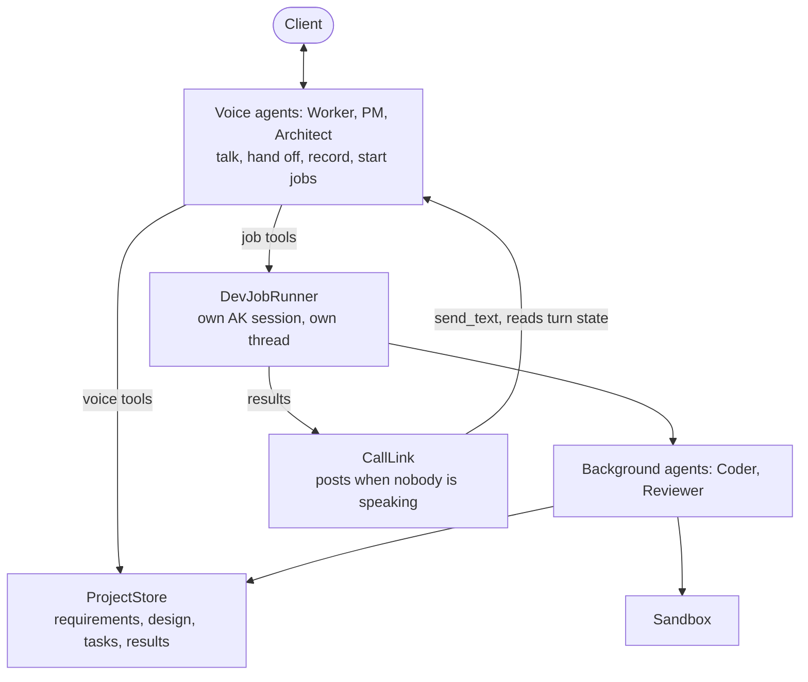

# #810: Realtime multi-agent collaboration with background work

A LiveKit voice example in which a human client meets a team of three voice agents (Worker, PM, Architect). The agents discuss the project, challenge each other and ask the client only business questions. Two background text agents (Coder, Reviewer) then build and review the software in the sandbox. The design idea: voice is the meeting room, not the engine. Voice agents talk and start work through short tools; background agents do the long work and report back into the call. Three small core changes make this possible: ADK tool callbacks in realtime, read-only turn state on the realtime connection, and history that says who said what after a Gemini transfer.

## Motivation

- #809 lets a call move between agents, but nothing shows agents collaborating on real work, and realtime models are built for conversation, not coding.
- Nothing can refuse a Gemini transfer, so agents with no client input can hand off to each other forever.
  - Realtime ADK calls `tool.run_async` directly (`ak-py/src/agentkernel/framework/adk/adk.py:1435`).
    - The agent's `before_tool_callback`, `after_tool_callback` and `on_tool_error_callback` never run; nothing under `ak-py/src/agentkernel/` references them.
    - ADK's own flow runs them around every tool call (`google.adk.flows.llm_flows.functions`).
  - The built-in `transfer_to_agent` replaces any tool with the same name (`adk.py:1121`), so an example cannot wrap it.
  - OpenAI is already covered:
    - a handoff that raises leaves the agent as it is (`ak-py/src/agentkernel/framework/openai/openai.py:978`);
    - the pool returns the error to the model as the tool result (`ak-py/src/agentkernel/pipeline/realtime_pool.py:246-248`).
- Code outside the pool cannot tell whether the model is speaking or when the caller last spoke.
  - `RealtimeConnection.last_activity_at` cannot separate silence from speech: every caller audio frame updates it (`realtime_pool.py:270`), and so does every adapter event (`:119`).
  - Text sent into a call always starts a response: OpenAI sends `response.create` (`openai.py:932`). If a response is already running, the server's error is only logged (`openai.py:905`), so the text is never answered.
  - The OpenAI adapter reports `speech_started` (`openai.py:883`). The ADK adapter never does: it uses the caller's transcription only to detect barge-in while the model speaks (`adk.py:1250`).
- After a Gemini transfer, the new agent cannot tell a teammate's words from its own, so agents cannot talk to each other.
  - The ADK adapter replays every agent's turn as the model's own (`role="model"`, no author).
  - ADK presents other agents' turns as user-side context naming the author (`[architect] said: ...`), and on a Live transfer does so for every agent's turns (`google.adk.flows.llm_flows.contents._present_other_agent_message`).
- A long-running background agent cannot share the call's session.
  - The pool runs each tool as a task (`realtime_pool.py:131`) inside the AK session lock (`:244`).
  - `Runtime.run` holds the same lock for a whole run (`ak-py/src/agentkernel/core/runtime.py:393`).
  - So a background agent on the call's session would freeze every voice tool call until it finished.
- The rest is already in place and needs no change:
  - **Text into a live call:** `RealtimeConnection.send_text`, thread-safe (`realtime_pool.py:275`); the connection is found with `RealtimeConnectionPool.get().get_connection()` (`:336`, `:441`).
  - **Sandbox tools for chosen agents only:** `sandbox.agents` (`ak-py/src/agentkernel/core/tool.py:167`, `:195`).
  - **One sandbox shared per AK session:** the sandbox registry is kept in that session's cache (`ak-py/src/agentkernel/sandbox/manager.py:451-458`); files are copied out with `ExecutionManager.download` (`:102`).

## Requirements

### Core change A: ADK tool callbacks in realtime (`GoogleADKRealtimeRunner.execute_tool`)

- Run the calling agent's tool callbacks around every tool call, in the same order and with the same short-circuit rules as ADK's own flow:
  - `canonical_before_tool_callbacks(tool=, args=, tool_context=)`: the first one that returns a result supplies the tool's result, and the tool does not run;
  - `canonical_on_tool_error_callbacks(..., error=)` when the tool raises: a returned result replaces the error, otherwise the error propagates as it does today;
  - `canonical_after_tool_callbacks(..., tool_response=)`: the first one that returns a result replaces the tool's result.
  - Sync and async callbacks both work.
- Callbacks receive the same `ToolContext` the tool would.
  - `tool_context.actions.transfer_to_agent` is read after the callbacks, as in ADK. A callback that skips `transfer_to_agent` blocks the transfer; a callback that sets the action requests one.
- ADK's built-in `transfer_to_agent` goes through the callbacks like any other tool.
- ADK plugins do not run, because realtime has no ADK `Runner` or plugin manager. This is documented.
- An agent with no tool callbacks behaves exactly as it does today.

### Core change B: realtime turn state (`RealtimeConnection`)

- New read-only properties; no configuration:
  - `is_responding`: true while model output has not yet left for the edge (audio, transcript or a control event still queued), or while a tool call is running until its result is sent (for an ADK handoff, that includes opening the next agent's socket);
  - `last_model_output_at`: epoch seconds when model output (audio or transcript) last left for the edge; `None` before that. A finished tool call does not count: its result is input the model has still to answer;
  - `last_model_generated_at` and `last_agent_change_at`: epoch seconds when the adapter last reported model audio or transcript, and a handoff (`agent_changed`), in the model's own time, ahead of pacing. Together they tell whether the agent now answering has said anything yet when it calls a tool such as a handoff; `last_model_output_at` cannot, as its words may still be queued;
  - `last_tool_result_at`: epoch seconds when a tool call's result was last sent to the model; `None` before that. Until `last_model_output_at` is later, a reply is owed; for an ADK handoff the result seeds the next agent's socket, so it marks the new agent's turn;
  - `last_caller_speech_at`: epoch seconds when the caller was last heard speaking (`speech_started`, `interrupt`, `speech_heard` or `speech_stopped`); `None` before that. A long answer keeps it current as far as the model sends transcriptions while the caller speaks (on Gemini 3.x this needs a live check: ADK notes it sends a single final input transcription);
  - `last_edge_text_at`: epoch seconds when text from the edge last reached the model (typed chat, or a prompt the edge sends for the caller, such as the LiveKit greeting); `None` before that. `RealtimeConnection.send_text(text, from_edge=True)` marks it, which `RealtimeConnectionPool.dispatch` passes for text requests; text an application sends itself does not;
  - `is_caller_speaking`: true from the caller starting to speak until the adapter reports `speech_stopped`; only on an adapter that declares `RealtimeRunner.reports_speech_stopped` (OpenAI's server VAD), always false otherwise.
- Two new adapter events, neither reaching the edge:
  - `speech_heard`: the caller is still speaking. The ADK adapter reports it on each transcription of the caller's words after the first, while the model is silent;
  - `speech_stopped`: the caller stopped. The OpenAI adapter reports it on `input_audio_buffer.speech_stopped`. Gemini Live does not signal the end of speech, so the ADK adapter does not.
  - Model audio also ends `is_caller_speaking`, should a stop never arrive.
- Safe to read from another thread.
- The pool cannot see the model generating before its first output. Consumers therefore check that the model owes no reply (`last_model_output_at` later than the caller's speech, the edge's text, the last tool result and their own last post, each waited for a bounded time) on top of `is_responding`; this limit is documented. On Gemini Live a completed text turn interrupts a response still being generated, so a consumer that took the gap after a tool result for silence would cut the reply off.
- The ADK adapter reports `speech_started` once per caller turn: on the caller's first transcription while the model is not speaking.
  - Barge-in while the model speaks is unchanged.
  - The pool already treats `speech_started` as a barge-in only while audio is queued (`realtime_pool.py:125-127`).
- No change to the stream events, the queue messages or the edge.

### Core change C: authored history on a Gemini transfer (`GoogleADKRealtimeRunner`)

- Every history entry records its author: `"user"` for the caller, else the agent that said it or made the call.
- The caller's transcribed words are also logged at the end of each turn (`Caller said: ...`, logger `ak.adk.realtime`), so a log shows both sides of the call; the LiveKit gateway already logs the agent's (`AI response: ...`).
- A socket opened by a transfer is seeded as ADK seeds one: the caller's words as they are, every agent's turn (the new agent's own included) through ADK's `_present_other_agent_message`, on the user's side and fenced as data.
- Imported from `google.adk.flows.llm_flows.contents`, where both ADK 1.24 (the floor) and 2.x provide it; private, like the `_build_transfer_instructions` #809 already uses.

### Example: `examples/api/livekit-voice/software-team/`

- Labelled a showcase in its README, which points to `google/handoffs` for the handoffs it builds on.
- Laid out for a first-time reader, in five Python files, each opening with a list of its sections:
  - `server.py`: start here; registers the team and serves it, with the client's page and the project board;
  - `agents.py`: who is on the team: the plain-English prompts, the voice agents (Worker, PM, Architect), the background agents (Coder, Reviewer);
  - `tools.py`: what the agents can do;
  - `team.py`: how the call is run, plain Python with no LLM (process rules, handoff guard, call link, jobs, activity, approval, call state);
  - `project.py`: what the team knows (records, the shared store, documents, the project folder).

#### Team

- **Voice agents** form one handoff group, each its own LiveKit participant (#809):
  - **PM** (entry agent): opens the meeting and starts the project, asks the business questions, owns requirements and acceptance criteria, answers the Coder's questions, checks acceptance;
  - **Worker**: plans the tasks, drives development and delivery;
  - **Architect**: owns the design, challenges technical choices, requests code review.
- **Background agents** use text models, are not in the handoff group, and never speak:
  - **Coder**: writes code and pytest tests in the sandbox, reports progress, asks the team questions;
  - **Reviewer**: reads the real code and runs the tests, then reports review findings or maps acceptance criteria to tests.
- The voice agents run on **Google ADK** with Gemini Live: the PM is the root agent, with the Worker and the Architect as sub-agents; transfers to parent and peers follow ADK's rules. The PM opens because a client meeting starts with the business; a Worker opening had to hand over to the PM before anything useful, and that first handover is where live runs stalled. Each agent has its own prebuilt voice.
- The Coder and the Reviewer are Google ADK agents too, on a text model through ADK's `LiteLlm` (`openai/gpt-4.1` by default, any LiteLLM `provider/model` by `TEAM_TEXT_MODEL`), as in `examples/api/adk`. One framework for every agent keeps the example readable; a build makes more model calls than the Gemini free tier allows, and ADK's default of 500 model calls per run needs no raising (the OpenAI Agents SDK stopped at 10 turns).
- Every voice prompt carries the meeting rules:
  - one complete turn per handover (up to five sentences); outside the design debate, as few handovers as the next step needs;
  - the design is a real debate, two to four rounds (a round is the Architect's turn and the Worker's answer): the Architect proposes the whole design and attacks it with concrete failure cases; the Worker answers every concern and attacks back (more than the requirements need, slow to build, hard to test); neither agrees because something sounds fine, each gives way only to a concrete argument and says what convinced them; no praise. The client asked for it: one polite exchange is neither realistic nor interesting to hear;
  - the debate holds in code: `ProcessGates` requires at least 2 rounds before `write_design` and refuses an Architect-to-Worker handover after 4 while the design is unwritten (`handover_blocker`, checked in the transfer's `before_tool_callback`); a round is counted on each performed Architect-to-Worker transfer before the design is written (`ProjectStore.count_design_round`, logged, so it also counts as progress for `HandoffGuard`); the handover brief names the round to the Architect only (told "round 1 of 2 to 4", the Worker acted out every round alone in one turn), and each later round must raise a new point; `design.md` shows how many rounds it took; a design changed after it was written starts its count again;
  - each thing is said once: when a tool answers mid-turn, the agent carries on without repeating itself;
  - every turn ends with a handoff, a question to the client, a started job, or, while background work runs and nobody needs an answer, waiting quietly;
  - business decisions go to the client through the PM; technical decisions are the team's;
  - every requirement, decision, assumption and open question is recorded with a tool;
  - no result is claimed without tool evidence.

#### Tools

- **Voice tools** return within a second. The job tools start background work and return a job id at once.

  | Agent | Tools |
  |---|---|
  | Worker | `create_tasks`, `start_development`, `deliver` |
  | PM | `start_project`, `settle_assumption`, `revise_requirement`, `drop_requirement`, `record_requirement`, `record_assumption`, `record_question`, `confirm_requirements`, `check_acceptance` |
  | Architect | `record_decision`, `record_component`, `write_design`, `request_review`, `rule_on_finding`, `approve_code`, `settle_assumption` |
  | Every voice agent | `get_project_state`, `get_progress`, `answer_coder` |
  | Coder | sandbox tools, `report_progress`, `ask_team`, `record_assumption`, `record_build_note` |
  | Reviewer | sandbox tools, `submit_review`, `submit_acceptance` |

- A requirement the client corrects is changed with `revise_requirement` (same id) or removed with `drop_requirement`: either unconfirms the requirements and drops that requirement's acceptance results; ids come from a counter, so a dropped id is never reused.
- `start_project` refuses once the requirements are confirmed: after a dropped model connection the new socket remembers nothing, and the PM must continue the recorded project, not rename it.
- A recorded decision also records the options it rejected and why, and the challenge raised in the debate and how it was answered; recording one with the same title revises it.
- `ask_team` waits up to 2 minutes for `answer_coder`, from the Architect for a technical question or the PM for a business one. With no answer, the Coder records an assumption and continues; every assumption the Coder records is posted to the call and starts unsettled; the PM (a business rule, after asking the client) or the Architect (a technical one) settles it with `settle_assumption`, and delivery waits until all are settled.
- A task is done only when the Coder reports it done and the tests pass; the job's update names unfinished tasks.
- A question to the client is noticed from the agent's words, not from a tool: `ClientQuestionWatcher` (a logging handler on `ak.integration.livekit`) reads each agent turn the gateway logs once its audio has played ("AI response: ..."), and a turn that ends with a question not addressed to a teammate ("Worker, ...?", "..., Architect?"), and did not end in a handover, marks the client's answer as pending, so the team is not nudged while the client is answering, and the board shows the question under "Waiting for you". An answer the client types counts as an answer.
  - an `ask_client` tool did this before, but a tool answering in the middle of a spoken turn makes Gemini Live start talking again: live, the PM asked one question three times, and every wording of the tool's reply failed in one call order or the other.

#### Project state (`ProjectStore`)

- One store per call, written to `TEAM_OUTPUT_DIR` (default `./output`) under a folder named from `start_project`; anything recorded before the project is named goes to a folder named after the call, which `start_project` moves. A folder an earlier call left is never reused (`login-system-2`), so no other project's files reach this one's documents or delivery.
- Holds:
  - requirements with acceptance criteria;
  - assumptions, open questions, decisions and design components;
  - tasks with status, and progress;
  - review findings and acceptance results;
  - a log of who recorded what, and when.
- Re-renders four documents on every change, without an LLM (`ProjectDocuments`): `requirements.md`, `design.md`, `status.md` (tasks, jobs, findings, acceptance and the outcome) and `log.md`. A `DocumentWriter` thread does the writing, coalescing changes, so a voice tool on the pool's loop never waits for files; change listeners are told once the documents show the change.
- The log tells records (a requirement, a decision, a job) from activity notes (a file written, a question put to the client): only records count as the team moving on, for `HandoffGuard` and the stuck-build check.
- `add_tasks` adds no task whose title is already there.
- Safe for concurrent use from the pool's event loop and from job threads.

#### Background work (`DevJobRunner`)

- Runs the Coder and Reviewer through `AgentService` in their own AK session, `<call session id>-dev`.
  - It is not the call's session, which would freeze voice tool calls (see Motivation).
  - The Coder and Reviewer share that session, so they work in one sandbox workspace and take turns.
- Each call runs one job at a time; a job requested while another runs is queued.
- Each job runs on its own thread and event loop, never on the pool's loop, so model calls and sandbox waits cannot stall the audio.
- Job kinds:
  - **develop:** listed task ids, or a list of findings to fix;
  - **review:** all the code, or only listed findings;
  - **acceptance:** map each acceptance criterion to a test result.
- A job's result is recorded in the `ProjectStore`. If the call is still connected, it is also posted to the call; if the call has ended, it is only recorded.
- `deliver` copies the sandbox workspace into `code/` and the last pytest output into `test-results.txt`.
- After 3 builds in a row that end with the same failing tests (`Job.tests`, run times aside), `start_development` is refused until a voice agent records something (a decision, a revised requirement) or the client speaks.
- The job thread and its event loop live for the whole call, never closed between jobs (LiteLLM keeps a logging task on the loop of its first call).
- Each background run starts from its brief only (`include_contents="none"` on the Coder and the Reviewer): the two share one AK session and so one ADK session, and every model call of every job would otherwise resend every earlier job, file writes and test output included.
- A review or acceptance job counts only once the Reviewer submits it (`ProjectState.review_submitted_at`, `acceptance_checked_at`): one that finishes without `submit_review` or `submit_acceptance` is asked once more, then fails.
- A build that ends with failing tests names them (pytest's `FAILED`/`ERROR` lines) in its update, `get_progress` and `get_project_state`, and the Coder's brief carries the end of the failing output, so the next build fixes what failed.
- The Coder's and the Reviewer's own words for a status are normalized ("completed" is done, "passed" a pass); a status that is neither is sent back. A review resolves only findings the Coder marked fixed.
- `copy_workspace` packs the workspace into one archive in the sandbox (a Python snippet: the sandbox always has Python, and GNU and BSD tar match exclusions differently) and downloads it once, falling back to one download per file.
- A failed background run (the runner's error reply, or an exception) fails its job, and the voice team is told not to restart it. After 2 failures in a row of one kind, that kind is refused until the client speaks.

#### Call coordination

- **`CallLink`** posts text into the call only when nobody is speaking:
  - it waits until `is_responding` and `is_caller_speaking` are false, the model owes no reply (to the caller's speech, the edge's text or the link's own post, each for up to 15 s; to a tool result, for up to 8 s), and nothing has happened for 1.5 s, then calls `send_text("[Team update, not from the client] ...")`;
  - an update can carry a check that it still applies, made just before posting (a Coder question that timed out is dropped); a full queue drops its oldest update with a warning;
  - it nudges a stalled team, once the client has spoken or typed: after 5 s with nothing said or given, no running job, no pending client question and no plan waiting for the client's approval, it posts a nudge that also covers the commonest stall (an agent naming a teammate without handing over). It nudges at most 2 times in a row, and watches the call from the moment the call is first seen;
  - it notices when the pool replaces the model connection (a new one starts at the PM and remembers nothing): its posts and nudges start over, and the PM is told where the recorded project stands and the client's name (kept from the page's `/token` request). Only the latest renewal's notice is posted, written when it is posted: live, failed reconnect attempts each queued a notice, and thirteen of them, each saying "the Worker delivers the project" after it had, made the Worker deliver thirteen times;
  - an update may be a function that writes it when it is posted, so it says where the project stands then; a tool result is waited on for up to 15 s (live, a reply started 10 s after one).
- **Running work is visible, not narrated**:
  - a job tool's reply states what was started; the meeting rules say to announce a job once, in one sentence;
  - `ActivityFeed` records every Coder and Reviewer tool call in plain words, from ADK's `after_tool_callback`, and `ModelWaitWatcher` adds the `openai` client's rate-limit retry waits (LiteLLM's OpenAI calls go through it); the board's job card shows the latest, and `get_progress` answers "how is it going?";
  - nothing is narrated into the call while a job runs: a Live model answers every completed turn, so periodic progress posts came out as the same status line again and again. Only events that need the team post: a job's result, the Coder's question or assumption, the client's click or file.
- **Relaxed tone** (meeting rules): the agents never rush the client, ask them to wait or stay longer, apologize for how long something takes, or talk about the team's rules and limits; a "Not ..." tool answer is for the team, not the client; while a job runs and nobody needs an answer, the agent stops talking until there is news. Live, the client heard "we need a bit more time", the handoff limit, and "I can't start the build yet".
- **`ProcessGates`** keep the SDLC order whatever the model does: `create_tasks` and `start_development` need confirmed requirements and a written design; `write_design` needs a component and a decision, each decision with its challenge; `request_review` needs a finished build; `check_acceptance` needs a review of the latest build and every finding `resolved` by the Reviewer (a `fixed` finding is re-reviewed first; a re-review the Reviewer does not confirm puts it back to `to fix`); `deliver` needs every task done (the Coder is asked once more when a develop job ends with no task reported), an acceptance check run after the last build, covering every current criterion, all passing, and every Coder assumption settled, so a requirement added later needs a new check. `DevJobRunner` runs the same check again when a queued job starts and skips a job that no longer passes, so a delivery requested during a new build cannot ship it unchecked. A blocked tool returns why and who should act, and starts nothing.
- **Delivery** with failing tests, or with no code copied out of the sandbox, does not mark the project delivered.
- **The code review is a conversation** (the client asked for a realistic review, not "fix all findings"):
  - the background Reviewer still reads the real code and lists findings, so the questions are grounded; a finding is `open` (to discuss), `to fix`, `fixed` (by the Coder), `resolved` (the Reviewer confirmed it) or `waived` (with the Architect's reason);
  - the Architect puts every finding to the Worker as a question about the code, in one turn; the Worker answers each (a fix, or a defence from the Coder's build notes, the decisions or the requirements, never invented); the Architect rules on each with `rule_on_finding` (`fix` or `waive`, with the reason); at most 2 rounds;
  - `ProcessGates`: `rule_on_finding` needs at least one round (an Architect-to-Worker handover while findings are open, counted by `ProjectStore.count_review_round`); `start_development` with finding ids builds only findings ruled `to fix`; a third round is refused (`handover_blocker`); a re-check the Reviewer does not confirm returns a finding to `to fix`;
  - `approve_code` (Architect) needs the review settled (the latest build reviewed, every finding resolved or waived); `check_acceptance` needs that approval to be newer than the latest build and review; the board's Review step is done, and its **Code review** card shows "Approved by the Architect", from the same check;
  - the PM then checks acceptance and tells the client how the review went.
- **Build notes**: the Coder records each choice the design did not settle with `record_build_note` (choice and reason); they go to `design.md`, the voice agents' overview and the background agents' brief, so the Worker answers "why?" from what was actually decided.
- **Coder questions are talked through**: a technical question goes from the Worker, with its view, to the Architect, who decides and answers with `answer_coder`; the Coder now waits up to 2 minutes (was 1).
- **A job starts once its announcement has been heard**: a tool runs as soon as the model calls it, while the words before it are still being played at speaking pace, so live a review was done on the board before the client heard the Architect ask for it. `DevJobRunner` waits, at most 20 s, until `CallLink.heard()`: no audio still queued (`is_responding`), none for 1 s (`last_model_output_at`, core change B), and, after a tool result, up to 4 s for the words an agent says after the call.
- **The agent that starts a job keeps the call** until its result comes (`TeamCall.job_blocker`, checked in the transfer's `before_tool_callback`): while a job runs, a handover goes through only when something new came since the agent got the call (the client spoke or typed, a team update arrived, the Coder has an open question). Live, while a review ran, the call bounced between the Worker and the PM, each repeating the status, and the handoff the review's result needed was then refused as a loop. The handover brief for a running job says nothing is needed from anyone until its result.
- **One transfer per turn, and none in silence during a debate**: a transfer from an agent that has already handed the call over is refused, and so, in the design debate or the code review, is one from an agent that has said nothing since it got the call (`last_model_generated_at` against `last_agent_change_at`, core change B). Live, a double transfer and silent bounces counted as rounds, so "four rounds" were about one and a half spoken ones.
- **No job twice**: a job identical to one already queued or running is refused, and a delivery is refused once the project is delivered, until something is built after it.
- **`HandoffGuard`** stops handoff loops, and nothing else:
  - at most 6 handoffs in a row with nothing to show for them: the count restarts when the client speaks or types (`last_caller_speech_at`, `last_edge_text_at`), a voice agent records something (not an activity note), or a job finishes (its result is news the team must act on), so a design debate that keeps agreeing things is not cut off; the refusal tells the agent to tell the client where the team has got to and ask what they think;
  - the refusal says it is internal, never to be mentioned to the client: an agent told only "refused" explained the limit to the client;
  - there is no per-minute limit: one was tried, for the free tier's 65,000 Gemini Live input tokens a minute (each handoff opens a session of 5,000 to 9,000 tokens), but it paused healthy design discussions and made the agents wait out loud; the prompts keep handovers few, and the README recommends a billing-enabled key;
  - it is a `before_tool_callback` on `transfer_to_agent` (core change A).
- **Handover brief**: an `after_tool_callback` on a performed transfer replaces its result with where the project stands and who acts next (`ProcessGates.next_step()`), which the agent taking the call reads in the replayed history:
  - live, an agent handed the call without a question took it as the wrong step ("I can't build yet") and handed it straight back;
  - an agent handing over says, by name, what it wants (a question, or the step that is now the teammate's); an agent handed the call with no question, while the step is the teammate's, gives its view on that step and hands back;
  - a refused transfer keeps its refusal.
- A greeting request arriving again later in the call (the client's microphone reconnected, and the gateway greets on every new audio track) is a completed turn, so the model answers it; the meeting rules keep that to one short sentence at most, with no second greeting.
- The handover brief, the meeting rules and the tool replies are written for how a re-seeded socket reads the call: ADK presents every earlier agent turn and tool result, the new agent's own included, as quoted data, never as instructions. So the brief states facts, each agent is told that lines with its own name are what it already said, and only the latest team update is current.

#### Project board and the client's page

- Voice alone left the client blind: what was agreed, what is being built and what the team waits for were spoken once and gone. The client now follows the project on screen while talking.
- **`ProjectBoard`** (`server.py`) joins the room as one more participant, `project-board` ("Project board"), with a token that publishes data only (`can_publish=False`, `can_subscribe=False`, `can_publish_data=True`).
  - It runs on a thread and event loop of its own, never the realtime pool's.
  - It sends a `BoardSnapshot` as JSON on the topic `ak.project` with LiveKit text streams (`send_text`): to every viewer (everyone but the `agent-*` participants, which run in the same process and would only log that they ignore the topic) after a project change, at most once a second (later changes coalesce into the next send), and to each participant that joins, so a page opened or reloaded mid-call starts full.
  - It never reaches the agents: the gateway takes only audio and the chat topics as the client's input, and the board sends neither. No core change: the example uses the LiveKit SDK Agent Kernel already installs.
  - It is visible, not `hidden`, since a hidden participant's data delivery is unverified; the client's page draws no tile for it.
  - With no LiveKit URL, key or secret it does not start, and the call works as before.
- **`BoardSnapshot`** (pydantic, from `ProjectState` and the call, no LLM): project, goal, phase, the SDLC steps (Requirements, Design, Approval, Build, Review, Acceptance, Delivered, done from the same checks as `ProcessGates`), `approval_pending`, the last 15 log entries, requirements with each criterion's acceptance result, decisions with their challenge, tasks, the running job with its last 5 activities, findings, the test summary, the delivered folder, and **waiting for you** (the question just asked, open questions, the Coder's unsettled assumptions).
- **The client's own words** reach the page with no core change: `ClientWordsWatcher` (a logging handler on `ak.adk.realtime`) picks up the adapter's `Caller said: ...` line, logged when the model has answered the turn, and the board sends it on its `ak.client` topic. Gemini only. The client joins under their name (capitals kept in the identity), which the gateway's greeting already uses.
- **Typing, sharing, documents and files on the page** (example only):
  - the client's token may publish data, so the page's message box sends to the room chat, which the gateway already passes to the agent with the call as the client's words;
  - `POST /project/share` saves a file in the project's `shared/` folder (`ProjectFiles`, a safe name, at most 10 MB), records it (`SharedFile`), announces it to the team (a short text file quoted, marked as data, not instructions), lists it in the Coder's brief, and a develop job uploads it to the sandbox under `shared/`;
  - `GET /project/files[/{path}]` and `GET /project/download` (a zip) read the project folder, never outside it; the board's Documents tab renders the live markdown (no HTML injected) with print-to-PDF, and its Files tab lists, views and downloads the files.
- **Approval with a click** (`ClientApproval`, `team.py`): checking the plan by ear is hard, so the client approves the requirements and the design together on the page:
  - `confirm_requirements` needs a written design (a `ProcessGates` check), so the approval stage is reliable: live, the PM had confirmed before the Architect wrote the design;
  - once the design is written and the requirements are not yet approved, the board's Project tab shows **Ready for your approval**: the live `requirements.md` and `design.md` in a scroll box, with **Looks good, build it** and **I'd like a change**; the page brings it into view once, when it appears;
  - `POST /project/approval?decision=approve|change&by=<name>`: an approval records the confirmation under the client's name, marks the question to the client answered, and tells the team it is recorded (not to call `confirm_requirements`) and to hand to the Worker; a change request tells the PM to ask what; either answers `409` when nothing waits for approval;
  - saying yes out loud still works: the PM calls `confirm_requirements`.
- **`ProjectStore.on_change(listener)`**: called after every change, on the changing thread under the store's lock; a listener only schedules work, and one that raises is logged, never failing the change.
- **The client's page** (`panel/`, Vite + React + `livekit-client`, like `examples/api/agui/frontend`): joins under the client's name (microphone, and data for the chat box), plays the agents, highlights the agent with `ak.active`, shows each agent's words from the gateway's chat topic, and draws the board.
  - Served by `ClientPage` at `GET /` from `panel/dist`, with `GET /token` minting the client's token (`RoomAccess`, from the `AK_LIVEKIT__*` settings the gateway uses); `api.custom_router_prefix: ""` mounts them at the root. The routes are unauthenticated, so `config.yaml` binds the server to `127.0.0.1`; opening it to a network (`AK_API__HOST`) needs authentication in front of it.

#### Classes

- Example-local classes, one job each:
  - `agents.py`: the prompts as plain constants (`MEETING_RULES`, `WORKER`, `PM`, `ARCHITECT`, `CODER`, `REVIEWER`); `VoiceTeam` (the three voice agents, written out one by one); `BackgroundTeam` (the Coder and the Reviewer);
  - `tools.py`: `TeamTools` (the tool sets, bound per role); `project.py`: `ProjectStore` and `ProjectDocuments`' `DocumentWriter`; `team.py`: `ProcessGates` and `HandoffGuard`, `DevJobRunner`, `CallLink`, `ActivityFeed` and `ModelWaitWatcher` (with `ClientWordsWatcher` and `ClientQuestionWatcher`, on one `LogLineWatcher` base that warns when a watched logger is set above INFO), `ClientApproval`;
  - `TeamCall`: one call's state (its store, jobs, link, guard and the Coder's open question); `TeamCalls` finds it from the session a tool runs in (the call's session or its `-dev` session);
  - `ProjectBoard` and `BoardSnapshot`, `RoomAccess`, `ClientPage`: the board participant, its snapshot, LiveKit tokens, and the client's page;
  - `SoftwareTeamServer`: loads the voice team and the background agents, starts the board, and serves the room and the client's page.
- This is not a core capability and selects no external backend, so it has no ABC or factory (house pattern 1).

### Core fix D: parallel tool calls on ADK (`GoogleADKToolBuilder`)

- Found live, with the Coder on `openai/gpt-4.1` through LiteLLM: a model's parallel tool calls failed with "Token ... was created in a different Context". The bug predates this change (it has been in `develop` since #221) and affects any ADK agent whose model makes parallel tool calls.
  - ADK runs parallel calls as concurrent tasks (`asyncio.gather`), and the tool wrapper activates the run's one shared AK `ToolContext` in each of them.
  - `ToolContext.set()` keeps the reset token on that shared instance, so one call overwrote another's token, and the first to finish reset with a token from another task.
- New `ToolContext.activated()`, a context manager that keeps the token with the caller. The ADK wrapper (sync and async) activates the context with it; `set()` and `reset()` are unchanged for their other callers, which activate once per run.

### Configuration

- No new `AKConfig` configuration.
  - `execution.mode: realtime`, as in the #809 examples, with `execution.realtime.playback_lead_ms: 300`: the default 50 ms of audio ahead of playback broke up live, in a process that also runs the background agents and the sandbox.
  - A `sandbox` block with `agents: [coder, reviewer]`, so voice agents never get the sandbox tools or the sandbox prompt section.
  - A `docker` profile by default. A `local_subprocess` profile is documented as a dev fallback with no isolation.
- Example-only environment variables, not part of `AKConfig`: `TEAM_OUTPUT_DIR` and `TEAM_TEXT_MODEL` (the background agents' LiteLLM model; providers retire text models often). Model keys and LiveKit settings are set as in the #809 examples.

### Verification

- Core change A unit tests:
  - a before-callback skips the tool and blocks a transfer;
  - an error callback replaces the error;
  - an after-callback replaces the result;
  - async callbacks work;
  - callbacks run as the calling agent;
  - with no callbacks, nothing changes.
- Core change B unit tests:
  - `is_responding` across audio, `done`, a running tool and a barge-in;
  - `last_model_output_at` counts output only; a finished tool call marks `last_tool_result_at` instead; `last_caller_speech_at` moves through a long answer; `last_edge_text_at` marks text from the edge (`from_edge=True`, passed by `dispatch`) and not an application's own `send_text`;
  - `is_caller_speaking` holds until `speech_stopped` on an adapter that reports it, and is false on one that does not;
  - the ADK adapter reports `speech_started` once per caller turn, `speech_heard` for its later words, and neither while the model speaks; the OpenAI adapter reports `speech_stopped`.
- Core change C unit tests: a seeded socket shows the caller's words as they are and each agent's turn, tool calls and results included, as `[agent] ...` context.
- Example tests (`demo_test.py`, no live models):
  - `ProjectStore` and `ProjectDocuments` rendering;
  - the voice team's transfer graph and callbacks, and the background team on LiteLLM;
  - `HandoffGuard` counting and reset, and the handover brief at each stage;
  - `CallLink` waiting and nudging, against a fake connection: waiting for the reply to a tool result and to typed text, dropping an update that no longer applies, a full queue, a new connection;
  - `TeamCall`: no nudge while the plan waits for approval, the PM told where the project stands after a new connection, a timed-out Coder question not posted;
  - `DevJobRunner` running one job at a time and handling an ended call, against a fake agent; a review or acceptance check never submitted, failing tests named and given to the next build, the workspace copied as one archive or file by file;
  - the tools: no task created twice, the Coder's and Reviewer's words for done and pass, a review resolving only fixed findings, job tools that state facts;
  - the prompts' invariants (every tool a prompt names is one that agent has; ADK's transfer tool), not their wording, which is expected to be tuned;
  - the board's snapshot, its coalesced sends and the send to a joining participant (fake room), the change listeners, the tokens' grants, and the client page's routes.
- `panel/` type-checks and builds (`npm run build`).
- Live runs, done by the maintainer: the full flow with Gemini Live voices and the background agents on `openai/gpt-4.1` through LiteLLM.

### Docs

- `docs/docs/integrations/livekit.md`: the example, and ADK tool callbacks in realtime.
- `docs/docs/architecture/realtime-internals.md`: the turn state, `speech_started` from both adapters, and tool callbacks.
- `examples/api/livekit-voice/README.md` index, and the example's own README.

## Non-goals

- Creating a GitHub PR, merging, or deploying.
- The client leaving and rejoining, and project state that lasts across calls.
- Calls longer than about 10 minutes. Gemini Live session limits are not handled.
- Multiple Agent Runner replicas or broker transports for the example: `CallLink` and the jobs run in-process (`in_memory` only).
- Generated projects other than Python with pytest. The voice agents are told so and offer a Python web app instead. The sandbox could run Node with another image; supporting other stacks needs the test check (`DevJobRunner`) and the Coder's brief to follow the recorded stack. Previewing a built site needs a sandbox port/preview capability that does not exist yet. Both are follow-ups.
- An OpenAI Realtime voice team. The voices are Gemini Live only, which keeps one team definition; OpenAI voice handoffs are shown by `openai/handoffs`.
- ADK plugins in realtime.
- A text summary in the LiveKit chat. The outcome is spoken and saved to `status.md`.
- Turning the team, the project store or the job runner into a core capability.
- Follow-ups from review, not in this change:
  - stopping a running job ("stop building for now"): a background run cannot be interrupted cleanly;
  - a runnable result the client can try (needs a sandbox port/preview capability).

## Open questions

- Core fix D fixes a bug already in `develop`: ship it as its own `fix:` PR first?

- Should core change A ship as its own `fix:` PR? It stops realtime ignoring ADK tool callbacks for every user, whether or not they use this example.
- Should `CallLink`'s "post only when nobody is speaking" logic become a pool method instead of example code? Every app that pushes background updates into a call needs it.
