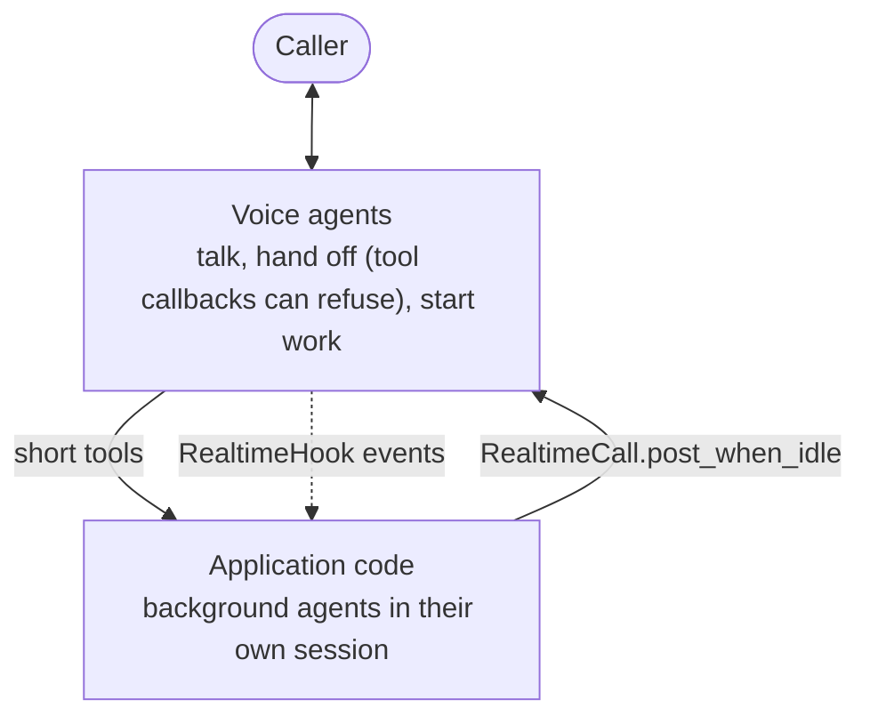

# #810: Realtime multi-agent collaboration with background work

Realtime support for applications in which voice agents and background agents work together: voice agents talk to the caller, hand off to each other and start work through short tools; background agents do the long work in their own sessions and report back into the call. The design idea: voice is the meeting room, not the engine. Seven core changes make this possible: ADK tool callbacks in realtime, read-only turn state on the realtime connection, history that says who said what after a Gemini transfer, a fix for parallel tool calls on ADK, talking into a live call at a quiet moment, realtime hooks that observe a call, and LiveKit tokens for an application's own users. They were driven by a full application kept outside this repository.

## Motivation

- #809 lets a call move between agents, but realtime models are built for conversation, not long work, and nothing lets an application run work beside the call and bring its result back.
- Nothing can refuse a Gemini transfer, so agents with no caller input can hand off to each other forever.
  - Realtime ADK calls `tool.run_async` directly (`ak-py/src/agentkernel/framework/adk/adk.py:1435`).
    - The agent's `before_tool_callback`, `after_tool_callback` and `on_tool_error_callback` never run; nothing under `ak-py/src/agentkernel/` references them.
    - ADK's own flow runs them around every tool call (`google.adk.flows.llm_flows.functions`).
  - The built-in `transfer_to_agent` replaces any tool with the same name (`adk.py:1121`), so an application cannot wrap it.
  - OpenAI is already covered:
    - a handoff that raises leaves the agent as it is (`ak-py/src/agentkernel/framework/openai/openai.py:978`);
    - the pool returns the error to the model as the tool result (`ak-py/src/agentkernel/pipeline/realtime_pool.py:246-248`).
- Code outside the pool cannot tell whether the model is speaking or when the caller last spoke.
  - `RealtimeConnection.last_activity_at` cannot separate silence from speech: every caller audio frame updates it (`realtime_pool.py:270`), and so does every adapter event (`:119`).
  - Text sent into a call always starts a response: OpenAI sends `response.create` (`openai.py:932`). If a response is already running, the server's error is only logged (`openai.py:905`), so the text is never answered.
  - The OpenAI adapter reports `speech_started` (`openai.py:883`). The ADK adapter never does: it uses the caller's transcription only to detect barge-in while the model speaks (`adk.py:1250`).
- After a Gemini transfer, the new agent cannot tell a teammate's words from its own, so agents cannot talk to each other.
  - The ADK adapter replays every agent's turn as the model's own (`role="model"`, no author).
  - ADK presents other agents' turns as user-side context naming the author (`[architect] said: ...`), and on a Live transfer does so for every agent's turns (`google.adk.flows.llm_flows.contents._present_other_agent_message`).
- An application learns what was said in a call only from log lines (`AI response: ...`), which break silently when a log's wording changes.
- An application serving its users a page has to read `AKConfig` to sign their LiveKit tokens.
- A long-running background agent cannot share the call's session.
  - The pool runs each tool as a task (`realtime_pool.py:131`) inside the AK session lock (`:244`).
  - `Runtime.run` holds the same lock for a whole run (`ak-py/src/agentkernel/core/runtime.py:393`).
  - So background agents run in a session of their own; no core change is needed for that.

## Requirements

### Core change A: ADK tool callbacks in realtime (`GoogleADKRealtimeRunner.execute_tool`)

- Run the calling agent's tool callbacks around every tool call, in the same order and with the same short-circuit rules as ADK's own flow:
  - `canonical_before_tool_callbacks(tool=, args=, tool_context=)`: the first one that returns a result supplies the tool's result, and the tool does not run;
  - `canonical_on_tool_error_callbacks(..., error=)` when the tool raises: a returned result replaces the error, otherwise the error propagates as it does today;
  - `canonical_after_tool_callbacks(..., tool_response=)`: the first one that returns a result replaces the tool's result.
  - Sync and async callbacks both work.
- Callbacks receive the same `ToolContext` the tool would.
  - `tool_context.actions.transfer_to_agent` is read after the callbacks, as in ADK. A callback that skips `transfer_to_agent` blocks the transfer; a callback that sets the action requests one.
- ADK's built-in `transfer_to_agent` goes through the callbacks like any other tool.
- ADK plugins do not run, because realtime has no ADK `Runner` or plugin manager. This is documented.
- An agent with no tool callbacks behaves exactly as it does today.

### Core change B: realtime turn state (`RealtimeConnection`)

- New read-only properties; no configuration:
  - `is_responding`: true from a response's first audio or transcript until its `done` (or a barge-in), so a pause mid-answer with the paced audio run out is not its end (a lost `done` stops counting after 15 s without output); while model output has not yet left for the edge (audio, transcript or a control event still queued); or while a tool call is running until its result is sent (for an ADK handoff, that includes opening the next agent's socket);
  - `last_model_output_at`: epoch seconds when model output (audio or transcript) last left for the edge; `None` before that. A finished tool call does not count: its result is input the model has still to answer;
  - `last_model_generated_at` and `last_agent_change_at`: epoch seconds when the adapter last reported model audio or transcript, and a handoff (`agent_changed`), in the model's own time, ahead of pacing. Together they tell whether the agent now answering has said anything yet when it calls a tool such as a handoff; `last_model_output_at` cannot, as its words may still be queued;
  - `last_tool_result_at`: epoch seconds when a tool call's result was last sent to the model; `None` before that. Until `last_model_output_at` is later, a reply is owed; for an ADK handoff the result seeds the next agent's socket, so it marks the new agent's turn;
  - `last_caller_speech_at`: epoch seconds when the caller was last heard speaking (`speech_started`, `interrupt`, `speech_heard` or `speech_stopped`); `None` before that. A long answer keeps it current as far as the model sends transcriptions while the caller speaks (on Gemini 3.x this needs a live check: ADK notes it sends a single final input transcription);
  - `last_edge_text_at`: epoch seconds when text from the edge last reached the model (typed chat, or a prompt the edge sends for the caller, such as the LiveKit greeting); `None` before that. `RealtimeConnection.send_text(text, from_edge=True)` marks it, which `RealtimeConnectionPool.dispatch` passes for text requests; text an application sends itself does not;
  - `is_caller_speaking`: true from the caller starting to speak until the adapter reports `speech_stopped`; only on an adapter that declares `RealtimeRunner.reports_speech_stopped` (OpenAI's server VAD), always false otherwise.
- Two new adapter events, neither reaching the edge:
  - `speech_heard`: the caller is still speaking. The ADK adapter reports it on each transcription of the caller's words after the first, while the model is silent;
  - `speech_stopped`: the caller stopped. The OpenAI adapter reports it on `input_audio_buffer.speech_stopped`. Gemini Live does not signal the end of speech, so the ADK adapter does not.
  - Model audio also ends `is_caller_speaking`, should a stop never arrive.
- Safe to read from another thread.
- The pool cannot see the model generating before its first output. Consumers therefore check that the model owes no reply (`last_model_output_at` later than the caller's speech, the edge's text, the last tool result and their own last post, each waited for a bounded time) on top of `is_responding`; this limit is documented. On Gemini Live a completed text turn interrupts a response still being generated, so a consumer that took the gap after a tool result for silence would cut the reply off.
- The ADK adapter reports `speech_started` once per caller turn: on the caller's first transcription while the model is not speaking.
  - Barge-in while the model speaks is unchanged.
  - The pool already treats `speech_started` as a barge-in only while audio is queued (`realtime_pool.py:125-127`).
- No change to the stream events, the queue messages or the edge.

### Core change C: authored history on a Gemini transfer (`GoogleADKRealtimeRunner`)

- Every history entry records its author: `"user"` for the caller, else the agent that said it or made the call.
- The caller's transcribed words are also logged at the end of each turn (`Caller said: ...`, logger `ak.adk.realtime`), so a log shows both sides of the call; the LiveKit gateway already logs the agent's (`AI response: ...`).
- A socket opened by a transfer is seeded as ADK seeds one: the caller's words as they are, every agent's turn (the new agent's own included) through ADK's `_present_other_agent_message`, on the user's side and fenced as data.
- Imported from `google.adk.flows.llm_flows.contents`, where both ADK 1.24 (the floor) and 2.x provide it; private, like the `_build_transfer_instructions` #809 already uses.

### Core fix D: parallel tool calls on ADK (`GoogleADKToolBuilder`)

- Found live, with a background ADK agent on `openai/gpt-4.1` through LiteLLM: a model's parallel tool calls failed with "Token ... was created in a different Context". The bug predates this change (it has been in `develop` since #221) and affects any ADK agent whose model makes parallel tool calls.
  - ADK runs parallel calls as concurrent tasks (`asyncio.gather`), and the tool wrapper activates the run's one shared AK `ToolContext` in each of them.
  - `ToolContext.set()` keeps the reset token on that shared instance, so one call overwrote another's token, and the first to finish reset with a token from another task.
- New `ToolContext.activated()`, a context manager that keeps the token with the caller. The ADK wrapper (sync and async) activates the context with it; `set()` and `reset()` are unchanged for their other callers, which activate once per run.

### Core change E: talking into a live call (`RealtimeCall`, `RealtimeOutbox`)

- Every application that pushes background updates into a call needs to say them at a quiet moment, without cutting anyone off; reading the turn state (core change B) for that belongs in the pool, once:
  - `RealtimeOutbox`, one per session (not per connection, so posts outlive a reconnect): a post waits until the model is not responding, the caller is not speaking, the model owes no reply (to the caller's speech, edge text, a tool result or the last post, each for at most `REPLY_TIMEOUT_SECONDS`), and the call has been quiet for `QUIET_SECONDS`. A post with the same `key` replaces a waiting one; `withdraw(key)` drops one; posts expire after `expires_after`; at most `MAX_PENDING` wait.
  - A response counts as under way from its first audio or transcript until its `done` (or the caller barges in), so a pause mid-answer, with the paced audio run out, is not taken for a quiet moment; one whose `done` never arrives stops counting after `_UNFINISHED_RESPONSE_SECONDS` without output.
  - The pool's loop delivers posts every `_POST_POLL_SECONDS` with `RealtimeConnection.send_text`.
- `RealtimeCall(session_id)`, exported from `agentkernel.pipeline`, is the public face: `post_when_idle(text, key=, expires_after=)`, `withdraw(key)`, `connected`, `quiet_for()`, `agent_has_spoken`. Applications do not import `realtime_pool` or read turn state. In a process without the pool a post is dropped with a warning.
- No configuration: the thresholds are the ones live runs settled on, as class constants.

### Core change F: realtime hooks (`RealtimeHook`)

- Applications learn what was said in a call from typed events, not log lines.
- `RealtimeHook.on_event(session, agent, event)` in `core/hooks.py`, attached with `Module.realtime_hook(agent, hooks)` to the agent a call starts with, beside `pre_hook` / `post_hook`. `RealtimeEvent.type`: `connected`, `caller_said`, `edge_text`, `agent_said` (`interrupted`), `agent_changed`, `disconnected`.
- Events go through one queue and task per connection, in order, off the audio path; a failing hook is logged and the next runs; an agent without hooks gets neither.
- Adapter contract: an optional `caller_transcript` event. The Gemini adapter reports the caller's words when a turn ends (turn complete, a tool call, text sent in). The OpenAI adapter does not enable input transcription, so it reports none: documented, not faked.

### Core change G: LiveKit tokens and alias

- `agentkernel/livekit.py`, the integration's public alias, as `slack.py` is Slack's.
- `LiveKitEdgeGateway.participant_token(identity, name=None, **grants)`: signed with the key and secret the gateway already reads, for its own room, so an app serving its users a page never reads `AKConfig`. It refuses `AGENT_IDENTITY_PREFIX` identities, another room, and a gateway without a key and secret. The gateway's own agent tokens use the same signing helper.

### Configuration

- No new `AKConfig` configuration.

### Verification

- Core change A unit tests:
  - a before-callback skips the tool and blocks a transfer;
  - an error callback replaces the error;
  - an after-callback replaces the result;
  - async callbacks work;
  - callbacks run as the calling agent;
  - with no callbacks, nothing changes.
- Core change B unit tests:
  - `is_responding` across audio, `done`, a running tool and a barge-in, and through a pause mid-answer until `done`;
  - `last_model_output_at` counts output only; a finished tool call marks `last_tool_result_at` instead; `last_caller_speech_at` moves through a long answer; `last_edge_text_at` marks text from the edge (`from_edge=True`, passed by `dispatch`) and not an application's own `send_text`;
  - `is_caller_speaking` holds until `speech_stopped` on an adapter that reports it, and is false on one that does not;
  - the ADK adapter reports `speech_started` once per caller turn, `speech_heard` for its later words, and neither while the model speaks; the OpenAI adapter reports `speech_stopped`.
- Core change C unit tests: a seeded socket shows the caller's words as they are and each agent's turn, tool calls and results included, as `[agent] ...` context.
- Core fix D unit tests: one `ToolContext` active in concurrent tasks, each restoring its own token; the ADK wrapper's parallel calls sharing the run's context.
- Core change E unit tests: a post waits for a quiet moment; nothing is said into a busy or unready call, or into a response paused mid-answer; the model answers what it was given first, and an unanswered input stops holding the call after the timeout; one post is answered before the next; a keyed post replaces a waiting one; withdrawn and expired posts are never said; a full outbox drops the oldest; a new connection owes nothing to a post into the old one; through `RealtimeCall`: a post made before the call connects is said once it is quiet, `quiet_for` / `agent_has_spoken` / `connected`, and nothing reached without a pool.
- Core change F unit tests: a call's events in order from connect to close (`connected`, `agent_changed`, `caller_said`, `agent_said`, interrupted `agent_said`, `edge_text` and not the application's own text, `disconnected`); a failing hook logged and the next run; a failed socket reported once; edge text from another thread; no queue for an agent without hooks; `Module.realtime_hook` chaining; the Gemini adapter reporting the caller's words at turn end and before text is sent in.
- Core change G unit tests: the alias exports the gateway; a participant token joins the gateway's room signed with its key, carries the grants asked for, and is refused for an agent identity, another room, or no key.
- Live runs, done by the maintainer, with Gemini Live voices and background agents on `openai/gpt-4.1` through LiteLLM.

### Docs

- `docs/docs/integrations/livekit.md`: ADK tool callbacks in realtime, "Tokens for your users", "Talking into a live call", "Watching a live call".
- `docs/docs/architecture/realtime-internals.md`: the turn state, `speech_started` from both adapters, tool callbacks, `RealtimeOutbox`, realtime hooks and `caller_transcript`.
- `docs/docs/integrations/hooks.md`: `RealtimeHook`.
- `examples/api/livekit-voice/*`: the examples import the public aliases (`agentkernel.adk`, `agentkernel.openai`, `agentkernel.livekit`), and the `sqs` token handlers use `participant_token`.

## Non-goals

- Creating a GitHub PR, merging, or deploying.
- An example or use case of the whole pattern in this repository: the application that drove these changes is kept outside it.
- Calls longer than about 10 minutes. Gemini Live session limits are not handled.
- `RealtimeCall` across processes: it reaches a call only in the process that runs the realtime pool (the Agent Runner, which is every process of the single-process topology).
- ADK plugins in realtime.

## Open questions

- Core fix D fixes a bug already in `develop`: ship it as its own `fix:` PR first?
- Should core change A ship as its own `fix:` PR? It stops realtime ignoring ADK tool callbacks for every user.
- Stripping tool calls Gemini writes into its words (`transfer_to_agent{...}`) in the adapter was considered and not done: transcripts stream in pieces, so it would hold text back on guesses, and an application recovering a handoff the model wrote instead of made needs to see the words. Edges filter what they show.
